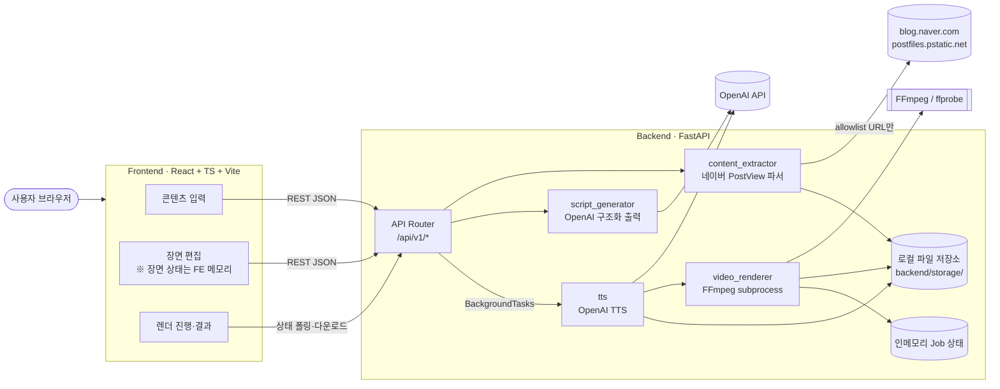
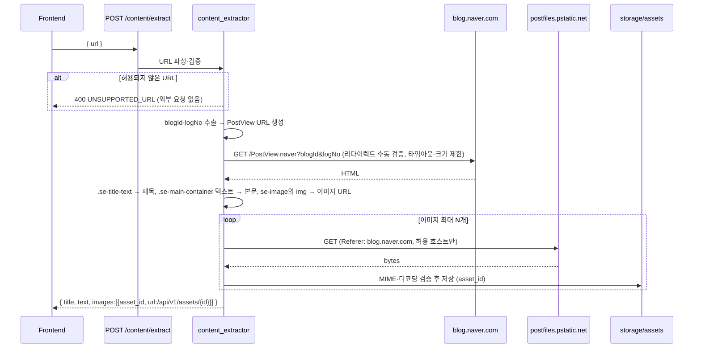
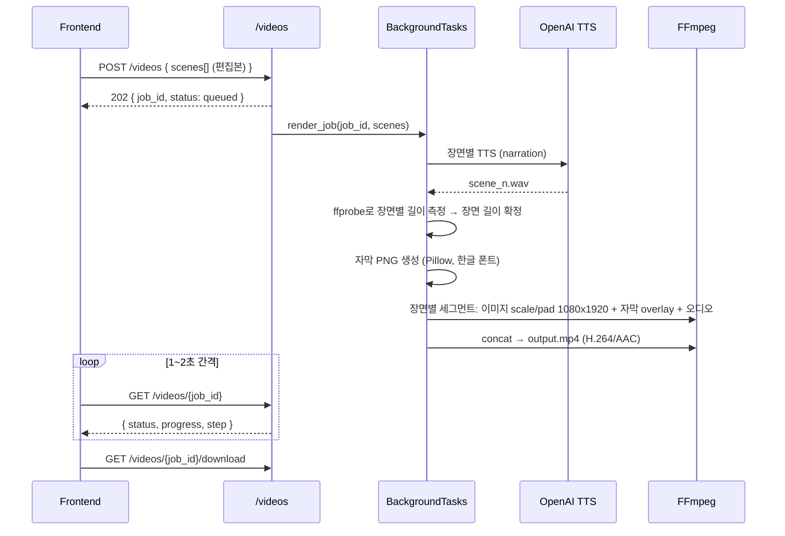

# 아키텍처 설계 — Blog to Shorts

> 상태: 설계안 v0.1 (2026-11-03) · 현재 구현된 것은 `GET /api/v1/health`와 프론트엔드 연결 확인 화면뿐이다. 나머지는 설계이며 구현 위치만 정해 둔다.

## 1. 전체 시스템 구조

Frontend(React SPA)와 Backend(FastAPI) 두 프로세스로 구성한 모노레포다. 외부 시스템은 네이버 블로그(콘텐츠 원본)와 OpenAI API(대본·TTS) 두 가지이며, 영상 합성은 백엔드 서버에 설치된 FFmpeg CLI로 처리한다. DB와 메시지 큐는 사용하지 않는다.



## 2. Frontend / Backend 역할

| 구분 | Frontend | Backend |
|---|---|---|
| 책임 | 화면 흐름(입력 → 편집 → 결과), 입력 1차 검증, 장면 편집 상태 보관, 렌더 상태 폴링, 미리보기·다운로드 | 입력 최종 검증, 콘텐츠 추출, OpenAI 호출, 이미지 다운로드·검증, TTS·자막·영상 합성, 작업 상태 관리, 파일 제공 |
| 비밀정보 | 없음 (`VITE_API_BASE_URL`만 사용) | `OPENAI_API_KEY` 등 모든 비밀정보 |
| 상태 | 장면 목록(편집본)은 React 상태 | 작업(job) 상태는 프로세스 메모리, 산출물은 파일 |

장면 편집 데이터는 **프론트엔드 상태로만 관리**한다. 편집 내용은 렌더 요청 시 장면 배열 전체를 한 번에 보낸다. 서버 저장이 없으므로 새로고침하면 편집 내용이 사라진다 (MVP 허용 범위, 필요 시 `localStorage` 임시 보관을 검토).

## 3. 백엔드 내부 구조

```
backend/app/
├── main.py            # create_app(): 미들웨어(CORS), 라우터 등록, 예외 핸들러
├── core/
│   └── config.py      # Settings(pydantic-settings) + get_settings()
├── api/v1/
│   ├── router.py      # /api/v1 prefix, 하위 라우터 include
│   └── health.py      # (구현됨) GET /health
│   # 추후: content.py, scripts.py, videos.py, assets.py
├── schemas/           # 요청/응답 Pydantic 모델 (health.py 구현됨)
└── services/          # (추후 생성) 비즈니스 로직 — 라우터는 얇게 유지
    ├── content_extractor.py   # URL 검증 + 네이버 PostView 파싱 + 이미지 수집
    ├── script_generator.py    # OpenAI Responses API + 구조화 출력
    ├── tts.py                 # OpenAI TTS → 장면별 오디오
    ├── captions.py            # 자막 이미지(PNG) 생성
    ├── video_renderer.py      # FFmpeg 명령 구성·실행
    ├── jobs.py                # 인메모리 Job 저장소
    └── storage.py             # 경로 규칙·정리(TTL)
```

규칙: 라우터는 요청 검증·서비스 호출·응답 변환만 한다. 외부 시스템 호출(HTTP, OpenAI, FFmpeg)은 `services/`에만 둔다. Repository 패턴·DI 컨테이너는 도입하지 않는다.

## 4. OpenAI API 연동 위치

- 호출 위치: `services/script_generator.py`(대본), `services/tts.py`(음성). **백엔드에서만 호출**한다.
- 키: `OPENAI_API_KEY` 환경변수 → `Settings.openai_api_key: SecretStr`. 로그·오류 응답에 키를 출력하지 않는다.
- 대본: Responses API + Structured Outputs(`responses.parse(text_format=PydanticModel)`)로 JSON 스키마를 강제하고, 받은 결과를 다시 Pydantic으로 검증(장면 수·순서·역할 규칙은 별도 validator). 거절(refusal)·불완전 응답(`incomplete`)은 오류로 처리한다.
- TTS: `gpt-4o-mini-tts`(`/v1/audio/speech`) 우선 검토. `tts-1`/`tts-1-hd`는 2027-01-06 종료 예정이므로 사용하지 않는다. 출력 형식은 합성 편의를 위해 WAV 또는 MP3.
- 모델명은 코드에 고정하지 않고 설정값(`OPENAI_SCRIPT_MODEL`, `OPENAI_TTS_MODEL`, `OPENAI_TTS_VOICE`)으로 둔다.

## 5. 블로그 콘텐츠 추출 흐름



- 네이버 블로그 글 주소(`/{blogId}/{logNo}`)는 iframe 껍데기이고 본문은 `PostView.naver`에 있다. 따라서 **입력 URL을 그대로 요청하지 않고**, 파싱한 `blogId`·`logNo`로 서버가 PostView URL을 직접 만든다.
- 예시 글(`copper567/224443571088`) 확인 결과: 스마트에디터 ONE 구조(`se-main-container`, `se-title-text`), 본문 이미지 8개, 이미지 호스트 `postfiles.pstatic.net`.
- 원본 이미지는 핫링크 제한 가능성이 있어 브라우저가 직접 불러오지 않고, 백엔드가 받아 `/api/v1/assets/{asset_id}`로 제공한다.
- HTML 파서 라이브러리(예: BeautifulSoup)와 HTTP 클라이언트(httpx)는 이 기능 구현 단계에서 추가한다.

## 6. 영상 생성 흐름



- 장면 길이는 **TTS 오디오 길이 + 여백(약 0.3초)** 으로 결정한다. 총 길이가 30~60초를 벗어나면 렌더 전 경고한다.
- 자막은 FFmpeg `subtitles`/`drawtext` 필터 대신 **자막을 PNG로 그려 `overlay`** 한다. 로컬 FFmpeg 9.0.2 빌드에 libass·freetype이 없어 두 필터를 쓸 수 없음을 확인했고, PNG 방식은 한글 폰트 처리도 단순하다.
- 상태 단계: `queued → running(step: tts | compose | encode) → succeeded | failed`.

## 7. 파일 저장 및 다운로드 전략

```
backend/storage/              # .gitignore 처리, 경로는 STORAGE_DIR 설정
├── assets/{asset_id}.{ext}   # 추출한 블로그 이미지
└── jobs/{job_id}/
    ├── audio/scene_{n}.wav
    ├── captions/scene_{n}.png
    ├── segments/scene_{n}.mp4
    └── output.mp4
```

- 파일명·경로는 서버가 생성한 UUID만 사용한다. 사용자 입력을 경로에 쓰지 않는다 (경로 탐색 방지).
- 다운로드는 `FileResponse`(`Content-Disposition: attachment`), 미리보기는 같은 파일을 `<video src>`로 재생.
- 정리 정책: 앱 시작 시와 일정 주기로 `FILE_TTL_HOURS`(기본 24h)보다 오래된 `jobs/`·`assets/`를 삭제. 중간 산출물(audio·captions·segments)은 성공 후 바로 삭제 가능.
- 영속성 한계: Job 상태는 메모리에 있으므로 **서버 재시작 시 진행 중 작업과 상태가 사라진다.** 컨테이너 배포 시 로컬 디스크도 휘발될 수 있다. 프로덕션에서는 오브젝트 스토리지(S3 등) + 작업 큐 도입을 추후 검토한다.

## 8. 보안 고려사항

| 위협 | 대응 |
|---|---|
| API Key 노출 | 백엔드 `.env`/환경변수에만 보관, `.env`는 Git 제외, `SecretStr`로 로그 마스킹, 프론트엔드 env에는 공개 값만 |
| SSRF | 임의 URL로 요청하지 않음: 스킴 `https`, 호스트 allowlist(`blog.naver.com`, `m.blog.naver.com`), blogId allowlist, 서버가 PostView URL 재조립. 리다이렉트는 자동 추종하지 않고 매 단계 allowlist 재검증. IP 리터럴·사설/루프백 IP로 해석되는 호스트 거부. 타임아웃(예: 10초)·응답 크기 상한(예: 5MB) |
| 악성 이미지 | 이미지 호스트 allowlist(`*.pstatic.net`), Content-Type + 실제 디코딩 검증, 크기 상한, 저장 시 재인코딩 |
| 경로 탐색 | 파일 경로는 서버 생성 UUID만 사용, `job_id`/`asset_id`는 UUID 형식 검증 |
| 명령 주입 | FFmpeg는 `subprocess.run([...])` 인자 배열로 호출(`shell=False`), 사용자 문자열은 명령 인자에 넣지 않음(자막은 PNG로 변환) |
| 비용 남용 | 입력 길이 상한, 장면 수 상한, OpenAI 타임아웃·재시도 횟수 제한. 공개 배포 시 레이트 리밋 검토 |
| CORS | 허용 Origin을 설정값(`CORS_ORIGINS`)으로 명시, `*` 사용 안 함 |
| 오류 노출 | 내부 예외 메시지·스택을 응답에 넣지 않고 `{error:{code,message}}`로 통일 |
